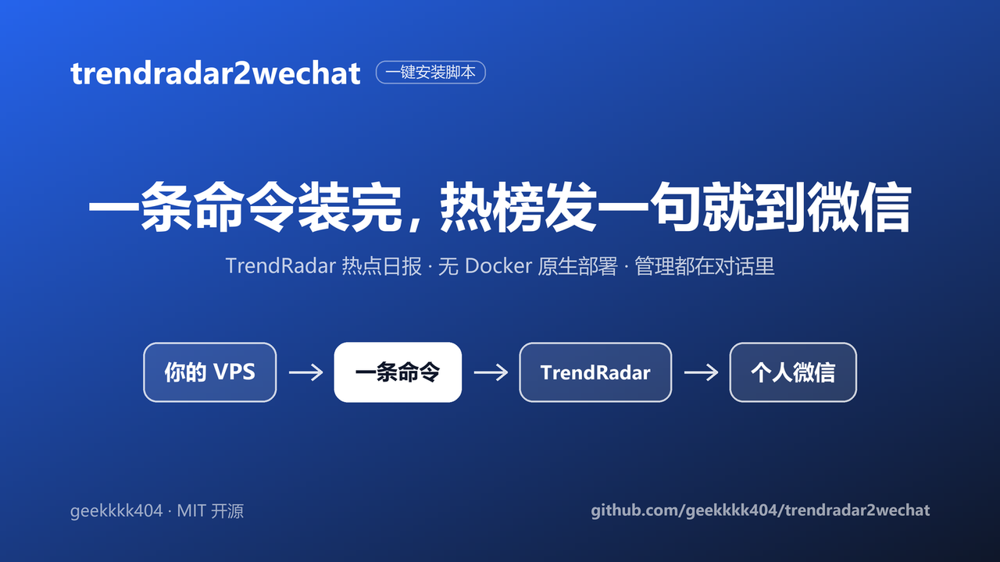
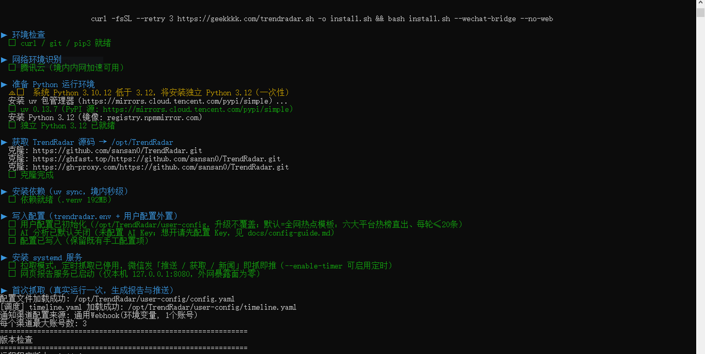
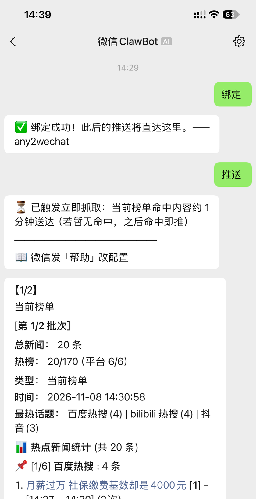
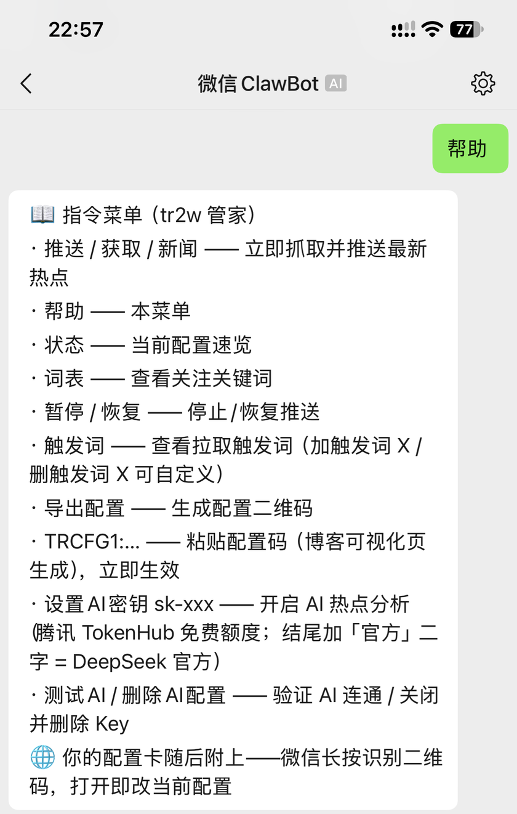
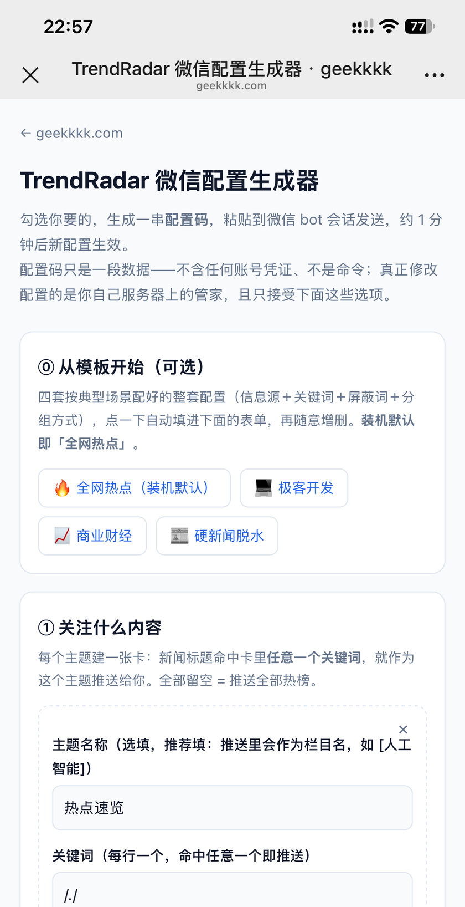
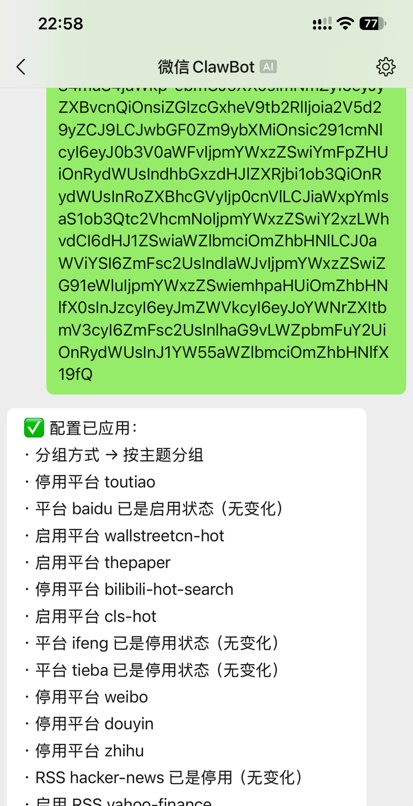

<div align="center">

# trendradar2wechat

**Rent a VPS, run one command, and get [TrendRadar](https://github.com/sansan0/TrendRadar) hot-topic digests delivered straight to your personal WeChat.**

[](LICENSE)
[](../../releases)
[](#quick-start)
[](#faq)

[中文](README.md) ｜ English



</div>

## What is this

A one-command installer built for non-technical readers:

- **Native deployment, no Docker** — Python/uv + systemd timers + a native Node bridge; a fresh VPS is ready in ~2 minutes
- **Adapts to domestic & overseas VPS** — mirrors auto-selected, idempotent re-runs, and upgrades never overwrite your configuration
- **Everything happens in a WeChat chat** — send "推送" (push) to receive the digest, send "帮助" (help) to manage it conversationally. Ships with the
  [any2wechat](https://github.com/geekkkk404/any2wechat) (MIT) bridge, which uses WeChat's iLink protocol (Tencent's official MIT code) — no WeCom, no ICP filing, no open inbound ports. (iLink is a fairly new interface and permanence is not guaranteed; see [Disclaimer](#disclaimer).)

## Demo

| Install: one command | Receive: digest in WeChat |
|:---:|:---:|
|  |  |
| **Manage: WeChat command menu** | **Configure: visual config page** |
|  |  |

## Quick Start

Run this in an SSH / Tencent Cloud OrcaTerm terminal (then follow the prompts to authorize via QR code and send any message to the bot in WeChat to complete binding):

```bash
curl -fsSL --retry 3 https://geekkkk.com/trendradar.sh -o install.sh && bash install.sh --wechat-bridge --no-web
```

- `--wechat-bridge`: built-in personal-WeChat push bridge (recommended; prints an authorization link during install, confirm on your phone)
- `--no-web`: keeps every inbound port closed (the safest form; the digest push does not depend on the web page)
- All options: `bash install.sh --help`

Requirements: Ubuntu 20.04+ / Debian 11+ (x86_64 / arm64), 1 GB RAM minimum, **no Docker needed**
(Python ≥3.12 is provisioned automatically; Ubuntu 24.04 already ships with it).

**Deploy-tested** (2026-11, Tencent Cloud Lighthouse x86_64): the full **Ubuntu 20.04 / 22.04 / 24.04 / 26.04** range —
20.04 (Python 3.8) exercises the script's standalone Python 3.12 install path, 26.04 (Python 3.14) exercises the system-Python path; both include bridge deployment and the in-terminal authorization QR code. Debian and arm64 are declared supported but not yet tested.
TrendRadar and the push bridge are fetched from their official repositories at install time and deployed natively; this repository only distributes the install script and documentation.

After install, send "帮助" (help) to the bot in WeChat for conversational management (pause/resume/change settings); for personalization we recommend the visual config page **[geekkkk.com/trcfg](https://geekkkk.com/trcfg/)** — it ships with four persona templates (the default "全网热点" / trending-everything, plus geek-dev, finance, and condensed hard-news) and generates a config code you paste to the bot to apply.

## How it works

```text
TrendRadar (Python + systemd scheduled fetch)
   │  GENERIC_WEBHOOK (an officially documented upstream option; zero upstream changes)
   ▼
any2wechat bridge (Node, listens on 127.0.0.1 only)
   │  WeChat iLink protocol (Tencent's official MIT code)
   ▼
Your personal WeChat (bind via QR scan; no WeCom, no ICP filing, no open ports)
```

Key design decisions (each backed by real measurements):

| Decision | Why, in one sentence |
|---|---|
| **Native deployment, no Docker** | Measured on the same box: 20min54s → 89s; ~400 MB disk footprint vs ~1.3 GB on the Docker route, with apt/uv/PyPI all on mainland mirror chains |
| **Pull mode by default** | Measured: iLink downstream credentials expire after ~30 minutes, so scheduled pushes inevitably fail; instead the bot fetches when you message it — your message carries a fresh credential, so pushes always arrive |
| **Config externalized to `user-config/`** | Personal settings live outside the git-tracked tree, so even `git reset --hard` during upgrades can't touch them |
| **Line-level patching + YAML gate** | Config edits touch only the target lines and preserve all upstream comments; files pass `yaml.safe_load` before hitting disk — bad results are rejected with zero changes written |
| **Interactive-terminal un-hijack** | A `$BROWSER` double-guard prevents `webbrowser.open` (after report generation) from hijacking the SSH terminal with a full-screen text browser |

## Configuration

After deployment, personalize keywords / grouping / sources via the **[config guide](docs/config-guide.md)** (in Chinese).
Reader configuration lives outside the source tree in `user-config/` and is **never overwritten** by upgrades or re-runs.

<div align="center"></div>

## FAQ

**How do I get TrendRadar digests pushed to my personal WeChat?**
That's exactly what this project does: one command installs TrendRadar plus the WeChat push bridge; after a QR-scan bind, digests arrive straight in your personal WeChat.

**Is there a route without WeCom (Enterprise WeChat) and without an ICP filing?**
Yes — zero WeCom, zero filing, zero open ports: the bridge speaks WeChat's iLink protocol over a localhost-only connection, and `--no-web` doesn't even open a web port.

**Do I need Docker?**
No. The default is native deployment (Python/uv + systemd + Node); Docker was the retired old route (21 minutes vs 89 seconds).

**Can I install it with zero Linux experience?**
Yes. The target reader is exactly that: one command, a QR scan, one "bind" message — then everything is managed from the WeChat chat.

**How do I change settings after install?**
Send "帮助" (help) to the bot, or use the visual config page [geekkkk.com/trcfg](https://geekkkk.com/trcfg/) to generate a config code and paste it to the bot; see the [config guide](docs/config-guide.md) (in Chinese).

## Disclaimer

- any2wechat is an independent open-source project, unaffiliated with Tencent and not endorsed or sponsored by it;
  "微信 / WeChat" is a Tencent trademark, used here solely to describe where messages are delivered.
- This project is unaffiliated with the official TrendRadar project: TrendRadar is GPL-3.0 open source
  ([sansan0/TrendRadar](https://github.com/sansan0/TrendRadar)); the script fetches the original code from its
  official repository at install time and integrates only through officially documented configuration options, without modifying its source.
- iLink is a fairly new interface that Tencent may change; no permanence guarantee is made.

## License

[MIT](LICENSE) (for the install script and documentation in this repository only; TrendRadar / any2wechat follow their own licenses)

## Acknowledgements

- [TrendRadar](https://github.com/sansan0/TrendRadar) (GPL-3.0) — the hot-trends aggregation engine itself
- [any2wechat](https://github.com/geekkkk404/any2wechat) (MIT) — the generic "any HTTP project → personal WeChat" push bridge
- [Tencent/openclaw-weixin](https://github.com/Tencent/openclaw-weixin) (MIT) — iLink protocol-layer reference
