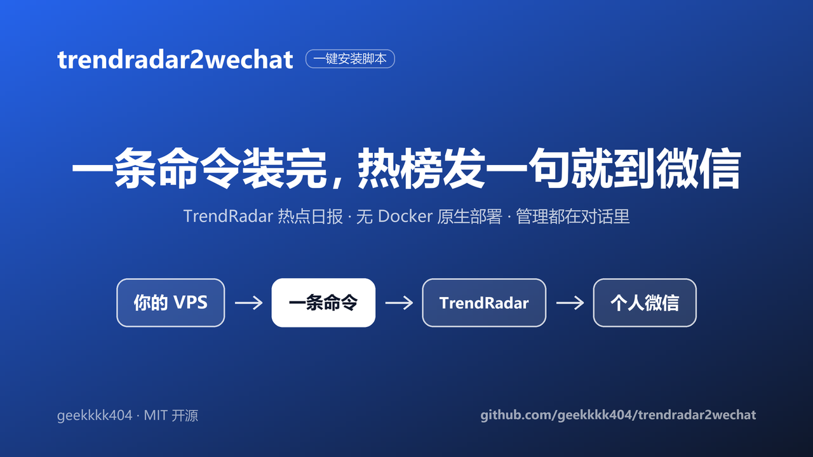
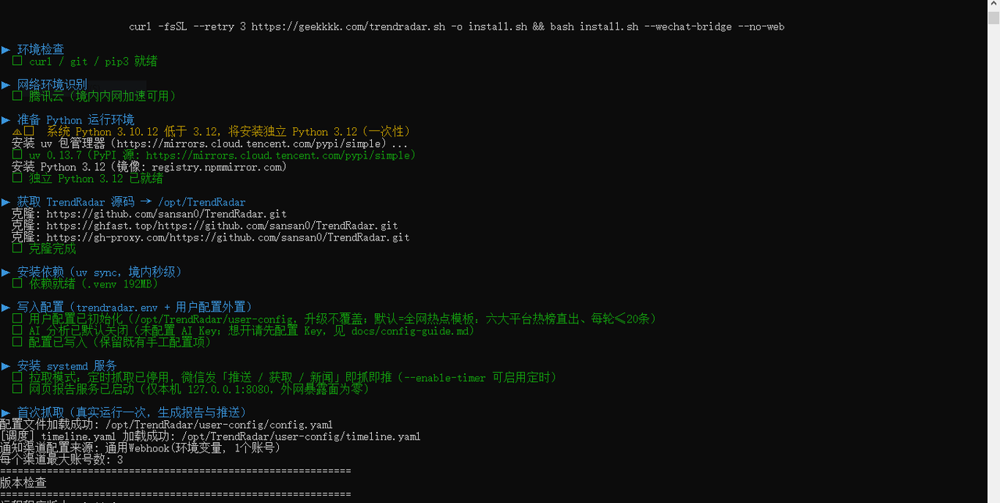
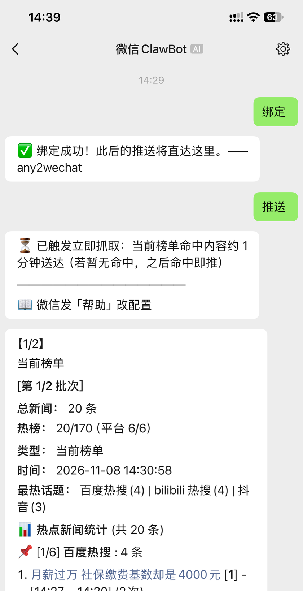
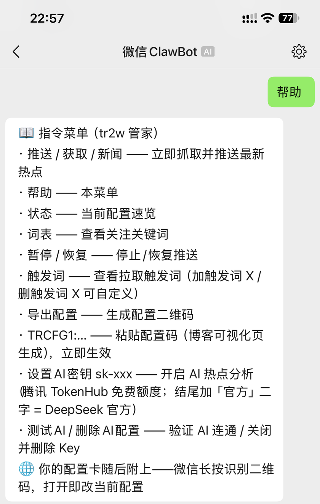
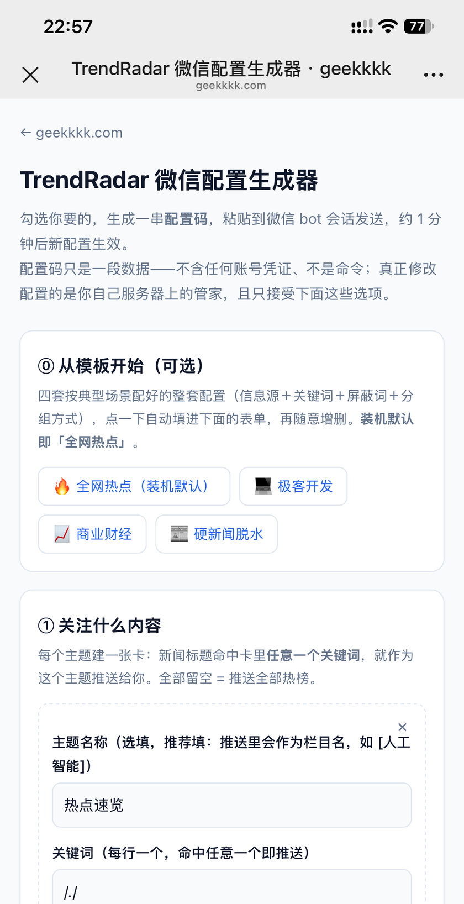
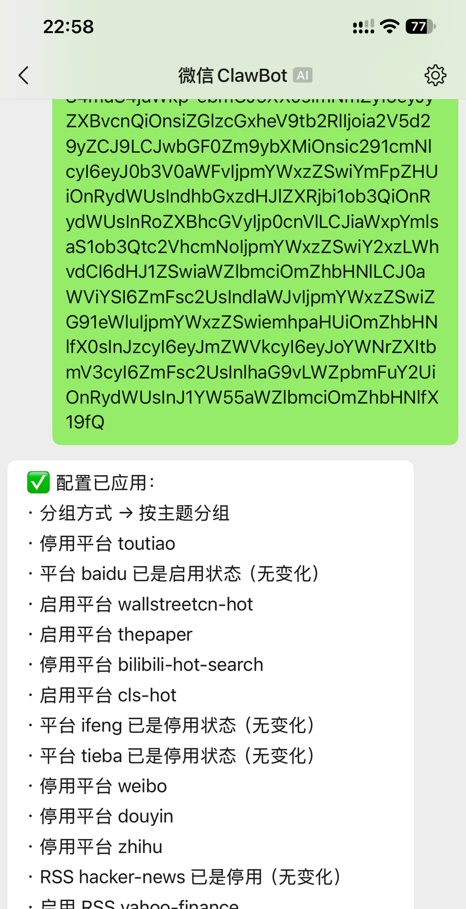

<div align="center">

# trendradar2wechat

**买台 VPS，一条命令，[TrendRadar](https://github.com/sansan0/TrendRadar) 热点日报直达你的个人微信。**

[](LICENSE)
[](../../releases)
[](#快速开始)
[](#faq)

中文 ｜ [English](README.en.md)



</div>

## 它是什么

面向零基础读者的一键安装脚本：

- **无 Docker 原生部署**——Python/uv + systemd 定时 + Node 原生桥，全新 VPS 约 2 分钟装完
- **境内外 VPS 自适应**——镜像源自动选路，幂等可重跑，升级永不覆盖你的配置
- **装完一切在微信**——发「推送」收热点日报，发「帮助」对话式管理；内置推送桥
  [any2wechat](https://github.com/geekkkk404/any2wechat)（MIT）走微信 iLink 协议（腾讯官方 MIT 代码），零企微、零备案、零公网端口（iLink 为较新接口，不承诺永久可用，详见[免责声明](#免责声明)）

## 效果速览

| 安装：一条命令跑完 | 收到：日报直达微信 |
|:---:|:---:|
|  |  |
| **管理：微信指令菜单** | **配置：可视化配置页** |
|  |  |

## 快速开始

在 SSH / 腾讯云 OrcaTerm 终端中执行（跟着提示扫码授权、微信里给 bot 发任意一条消息完成绑定即可）：

```bash
curl -fsSL --retry 3 https://geekkkk.com/trendradar.sh -o install.sh && bash install.sh --wechat-bridge --no-web
```

- `--wechat-bridge`：内置微信个人号推送桥（推荐；安装过程中出授权链接，手机微信确认）
- `--no-web`：不开放任何入站端口（最安全形态；热点推送不依赖网页）
- 全部选项：`bash install.sh --help`

要求：Ubuntu 20.04+ / Debian 11+（x86_64 / arm64），1GB 内存起，**无需 Docker**
（Python ≥3.12 由脚本自动准备，Ubuntu 24.04 自带）。

**已通过部署实测**（2026-11，腾讯云轻量 x86_64）：Ubuntu **20.04 / 22.04 / 24.04 / 26.04** 全系列——
20.04（Python 3.8）走脚本自动装独立 Python 3.12 路径，26.04（Python 3.14）走系统 Python 直用路径，均含微信桥部署与终端授权二维码。Debian 及 arm64 声明适用但尚未实测。
TrendRadar 与推送桥由脚本在安装时从各自官方仓库获取并原生部署，本仓库只分发安装脚本与文档。

部署后，微信里给 bot 发「帮助」即可对话式管理（暂停/恢复/改配置）；个性化配置推荐用
可视化配置页 **[geekkkk.com/trcfg](https://geekkkk.com/trcfg/)**——内置四套人群模板
（装机默认「全网热点」，另有极客开发/商业财经/硬新闻脱水）一键起步，也可自由勾选生成配置码，粘贴给 bot 即生效。

## 工作原理

```text
TrendRadar（Python + systemd 定时抓取）
   │  GENERIC_WEBHOOK（上游官方文档化配置项，零上游改动）
   ▼
any2wechat 桥（Node，仅本机监听 127.0.0.1）
   │  微信 iLink 协议（腾讯官方 MIT 代码）
   ▼
你的个人微信（扫码绑定，零企微 / 零备案 / 零端口开放）
```

几个关键设计决策（每条都有实测依据）：

| 设计决策 | 一句话理由 |
|---|---|
| **无 Docker 原生部署** | 同箱实测 20min54s → 89s；磁盘足迹 ~400MB（Docker 路线 ~1.3GB），apt/uv/PyPI 全走境内镜像链 |
| **拉取模式为默认** | 实测 iLink 下行凭证约 30 分钟过期，定时推送必然撞墙；改为发消息即抓——消息自带新鲜凭证，推送必达 |
| **配置外置 `user-config/`** | 个性化配置放在 git 跟踪树之外，升级重跑 `git reset --hard` 也碰不到 |
| **行级手术 + YAML 门禁** | 改配置只动目标行、保留上游全部注释；落盘前 `yaml.safe_load`，坏结果拦截、文件零改动 |
| **交互终端反劫持** | `$BROWSER` 双保险：治报告生成后 `webbrowser.open` 在 SSH 终端被文本浏览器前台接管 |

## 配置与自定义

部署后的个性化（关注关键词、推送分组、信息源取舍）见 **[配置指南](docs/config-guide.md)**。
读者配置外置于安装目录 `user-config/`（与上游源码隔离），升级 / 重跑安装脚本**永不覆盖**。

<div align="center"></div>

## FAQ

**怎么把 TrendRadar 的热点日报推送到微信个人号？**
本项目就是干这个的：一条命令装完 TrendRadar + 微信推送桥，扫码绑定后热点日报直达个人微信。

**有没有不用企业微信、不用备案的方案？**
有——本方案零企微、零备案、零公网端口：桥走微信 iLink 协议本机直连，`--no-web` 形态连网页端口都不开。

**需要 Docker 吗？**
不需要。默认原生部署（Python/uv + systemd + Node），Docker 是被淘汰的旧路线（21 分钟 vs 89 秒）。

**零基础能装吗？**
可以。目标读者就是零基础读者：一条命令 + 扫码 + 发一句「绑定」，之后一切管理都在微信对话里完成。

**装完之后怎么改配置？**
微信里发「帮助」，或用可视化配置页 [geekkkk.com/trcfg](https://geekkkk.com/trcfg/) 生成配置码发给 bot；详见 [配置指南](docs/config-guide.md)。

## 免责声明

- any2wechat 是独立开源项目，与腾讯公司无任何关联，亦未获其背书或赞助；
  "微信 / WeChat" 为腾讯商标，此处仅作描述消息去向之用途。
- 本项目与 TrendRadar 官方无关联：TrendRadar 为 GPL-3.0 开源项目
  （[sansan0/TrendRadar](https://github.com/sansan0/TrendRadar)），脚本在安装时从其
  官方仓库获取原版代码并按官方文档化配置项对接，不修改其源码。
- iLink 为较新接口，腾讯可能调整；不承诺永久可用。

## License

[MIT](LICENSE)（仅限本仓库的安装脚本与文档；TrendRadar / any2wechat 各自遵循其自身许可证）

## 致谢

- [TrendRadar](https://github.com/sansan0/TrendRadar)（GPL-3.0）——热点聚合引擎本体
- [any2wechat](https://github.com/geekkkk404/any2wechat)（MIT）——「任意 HTTP 项目 → 个人微信」通用推送桥
- [Tencent/openclaw-weixin](https://github.com/Tencent/openclaw-weixin)（MIT）——iLink 协议层参考
